# Latch

**Your coding agent's tests are green. Latch checks whether they could ever have been red.**

Latch is a merge gate for pull requests written by AI coding agents. It reads the issue the PR claims to fix, has NVIDIA Nemotron write one test for that issue, and opens only when the harness watches that test fail on the bug, pass on the fix, and fail again when the fix is undone. A model never decides the verdict. The harness does.

[**Try the hosted demo**](https://latch-mauve.vercel.app) · [Evidence page](https://latch-mauve.vercel.app/eval) · [Real PR comments](https://github.com/aarav1656/latch-demo/pulls) · [GitHub Action](https://latch-mauve.vercel.app/ship) · [Click #3299 receipt](https://latch-mauve.vercel.app/r/pallets/click/3299)

<p align="center"></p>

---

## The problem in one minute

Coding agents now write the fix **and** the tests for it, in the same pull request. CI goes green, the reviewer sees green, the PR merges. Nobody checked whether those tests could fail.

They often can't:

- Given only the buggy code, Claude Sonnet 5 wrote a suite that **passed on the bug in 53 of 54 runs**. Adding a written spec to the prompt lifted detection to 96%. ([Dik Rana, 2026](https://dikrana.dev/blog/agent-tests-lock-in-bugs/))
- 80.2% of 86,156 test-file patches in agent-authored PRs had a weak or missing oracle. ([arXiv 2606.18168](https://arxiv.org/abs/2606.18168))
- "All 12 tests passed. An independent verifier reversed the condition. All 12 still passed." ([@NatureBlueee](https://x.com/NatureBlueee/status/2115186551407944177))
- "Asked it to write tests. It handed me a PR full of green checkmarks that test absolutely nothing." ([Viljami Kuosmanen](https://www.linkedin.com/posts/anttiviljami_caught-claude-code-red-handed-again-asked-activity-7469105276210532352-mLSJ))

The usual advice is "make the agent run the tests". **Running a test that cannot fail proves nothing.** Latch asks the opposite question: would this test have caught the bug, and would it catch the fix being undone?

<p align="center">= 10 to seats > 10 leaves the shipped suite green because one test asserts a value equals itself; Latch's new test fails on the moved line and passes on the original"></p>

## Who it is for

| You are | Your pain | What Latch gives you |
|---|---|---|
| **A maintainer** of a Python library getting agent-written PRs | You can read the diff, but you can't tell if the new test would ever have caught the bug | A comment on the PR with one verdict and a receipt you can rerun |
| **A team** running Claude Code, Codex, Copilot agent or Devin on real repos | Agents ship tautological or bug-locking tests that pass review | A CI check that stays shut until a test is proven able to fail |
| **A reviewer** with fifty agent PRs in the queue | Reading every test line by line doesn't scale | A sort order: `VALIDATED` first, `FIX_FAILS_TEST` gets your attention |

## How it works

<p align="center"></p>

**The linked issue is the oracle.** Agent tests fail because they are written from the code, so they copy its bugs. Latch writes its test from the issue, the one description of correct behaviour the agent didn't author. Then five checks, all executed, no model vote:

| # | Check | What would make it fail |
|---|---|---|
| 1 | **Red on base.** The test fails on the commit before the fix, on an assertion | A test that passes on the bug shows nothing |
| 2 | **Green on fix.** It passes on the PR, with the repo's own suite still green | The fix doesn't do what the issue asks |
| 3 | **Stable.** Same answer over 5 reruns on each side | A flaky test is not evidence |
| 4 | **Red on revert.** The harness undoes the fix and the test must fail again | The test isn't actually tied to the change |
| 5 | **Kills mutants.** Small edits to the fixed lines (`>=` to `>`, `and` to `or`) must break the test, 60% or more | The test is too loose to pin the fix |

Pass all five and the gate opens with `VALIDATED`. Anything else gets a named refusal, so you know whether the **test** or the **fix** is the problem:

| Verdict | Means |
|---|---|
| `VALIDATED` | Red on base, green on head, stable, red on revert, mutants killed |
| `FIX_FAILS_TEST` | The test is sound; the fix doesn't satisfy the issue. **Look at this PR.** |
| `MUTATION_SURVIVED` | The test passes even with the fix mangled |
| `NO_REGRESSION_FOUND` | The test passes on base, so it shows no bug |
| `FLAKY` | Different results on repeated runs of the same code |
| `INVALID_TEST` | Latch couldn't build a sound test; says nothing against the fix |

Two models split the work on [Nebius Token Factory](https://tokenfactory.nebius.com): `nvidia/Nemotron-3_5-Lightning` maps the repo and confirms the base failure is the issue's own failure; `nvidia/Nemotron-3-Ultra-550b-a55b` reasons over the issue and the diff and writes the test.

## Results: 42 live runs

<p align="center"></p>

21 real bug fixes (9 upstream fixes from cachetools, boltons, tabulate, toolz, packaging, more-itertools and click, plus 12 SWE-bench Lite sympy instances), 9 hand-built plausible-but-wrong patches, and 12 runs where Nemotron writes the fix itself and the instance's hidden tests judge it.

| Measure | Result |
|---|---|
| **Wrong patches accepted** | **0 of 9** (6 of 9 failed by a valid proof test, the rest kept the gate shut) |
| Real fixes proven through all five checks | 10 of 21 (upstream 5 of 9, sympy 5 of 12) |
| Gate opened on a Nemotron fix the hidden tests reject | 0 of 12 |
| Mutants killed, across the 11 fixes that reached the mutation check | 28 of 31 (90%) |
| Flaky proof tests | 0 of 12 rerun |
| Cost | **$2.22 for all 42 runs**, median $0.018 per run, $0.22 per proven fix |

Every number is read from `latch/runs/eval-summary-repair.json`, and every graphic on this page is drawn from the committed receipts by `python3 docs/readme/build.py`. Method: `latch/loop/eval/RESULTS.md`.

The number a merge gate lives on is how often it opens for a wrong patch. For context, test generators measured on fail-to-pass alone report 31.4% (Otter, [arXiv 2502.05368](https://arxiv.org/abs/2502.05368)) and 43.6% (AssertFlip, [arXiv 2507.17542](https://arxiv.org/abs/2507.17542)) on a different benchmark with a looser pass condition.

## Try it

**In the browser.** Open [latch-mauve.vercel.app](https://latch-mauve.vercel.app) and browse recorded proofs, or run it locally and paste any public GitHub PR that closes an issue:

```sh
export NEBIUS_API_KEY=...        # Token Factory key
python3 latch/serve.py           # http://127.0.0.1:4173, paste a PR, press "Prove this fix"
```

**From the command line.** Python 3.10+, no dependencies.

```sh
pip install -e .
latch prove --repo . --base <sha> --head <sha> --issue-file issue.md --receipt receipt.json
latch loop  --repo . --base <sha> --head <sha> --issue-file issue.md   # shut gate? Nemotron repairs the fix, harness re-judges
latch comment receipt.json                                               # render the PR comment
latch demo --human                                                       # the bundled case, as a timeline
```

Exit status: `0` proven, `1` not proven, `2` error.

**On every pull request.** Copy [`latch/loop/github/latch.yml`](latch/loop/github/latch.yml) to `.github/workflows/`, add a `NEBIUS_API_KEY` secret, and Latch keeps one comment up to date on each PR. Fork PRs get no secrets, so the action fails closed. See it on three real python-tabulate PRs: [aarav1656/latch-demo](https://github.com/aarav1656/latch-demo/pulls) (validated, wrong patch kept shut, mutants survived).

<details>
<summary><b>Walkthrough: proving Click #3299 end to end</b></summary>

Click issue [#3298](https://github.com/pallets/click/issues/3298): help text crashes with `ValueError` when an option's default is a `semver.Version` and `show_default=True`. Fix: [#3299](https://github.com/pallets/click/pull/3299).

```sh
git clone https://github.com/pallets/click.git ~/click
git -C ~/click fetch origin pull/3299/head:latch-pr-3299
python3 -m venv ~/click-venv && . ~/click-venv/bin/activate
python3 -m pip install pytest semver==3.0.4
PYTHONPATH=/path/to/this/checkout python3 -m latch.prove \
  --repo ~/click \
  --base 04ef3a6f473deb2499721a8d11f92a7d2c0912f2 \
  --head d340b0c1202284a1b9d0ca892549208527d586ce \
  --issue 'Click help raises ValueError when a semver.Version(1, 0, 0) default has show_default=True. Help should render and show the default.' \
  --test-command 'python3 -m pytest -q' \
  --receipt click-3298.json
```

Ultra wrote `test_semver_version_default_show_default`. It failed 5 of 5 on base, passed 5 of 5 on the fix, failed again on revert and killed 2 of 3 mutants. The whole receipt cost $0.0066. Latch archives the commits into temporary directories and never checks out or edits your repository. The receipt holds captured pytest output, so inspect it before sharing if your tests print private values.

</details>

<details>
<summary><b>What is in a receipt</b></summary>

Every run writes one JSON receipt: both commit hashes, the generated test, base and head outputs, the verdict and its reason, every mutant with operator, line, diff and output, and `model_calls[]` with role (`repo_map`, `triage`, `test_writer`, `fixer`), model, tokens, latency, completion id and cost. Cost is an upper bound from Token Factory's published per-token prices. `steps[]` and the JSONL event stream carry `{step, status, ts, detail}` for `fetch`, `repo_map`, `base_run`, `head_run`, `revert_check` and the verdict.

</details>

<details>
<summary><b>Verdict rules, flake check and mutation check in full</b></summary>

The harness decides with fixed rules in `latch/verdict.py`; the first rule that matches wins: `INVALID_TEST` (vacuous, or errored at import, collection or runtime instead of asserting, or triage said the failure is not the reported one), `FLAKY`, `NO_REGRESSION_FOUND`, `FIX_FAILS_TEST` (still fails on head, or the repo suite goes red), `MUTATION_SURVIVED`, then `VALIDATED`.

**Test repair.** When a proof test errors instead of asserting (a missing import, or the bug's own exception escaping the test), Ultra gets that test's error output once and rewrites it; the rewritten test goes through every check again. The same 42 runs before repair shipped: 7 of 21 proven. Both runs are committed side by side: `latch/runs/eval-summary.json`, `latch/runs/eval-summary-repair.json`, `latch/runs/eval-diff-repair.md`.

**Flake check.** Before the revert check, Latch reruns the proof test on base and head (`--flake-runs N`, default 5, at most 10). No model runs. If either side disagrees with itself the verdict is `FLAKY`, and the receipt records `base_fail_rate`, `head_pass_rate` and `flake_rate`.

**Mutation check.** Latch mutates only the lines the fix changed (up to 5 mutants: flipped comparison boundaries, negated conditions, `and`/`or` swaps, off-by-one on integer constants, a `None` return) in temporary copies and runs the frozen test against each. The gate needs a kill rate of at least 60% (`--no-mutation` turns it off). A timed-out mutant counts as killed, an unrunnable one as survived; mutants the time budget stopped (240 s, 600 s under a custom runner, `LATCH_MUTATION_BUDGET` overrides) are recorded as `not_run` and excluded from the rate. A change with no mutable lines records `total: 0`.

**Revert check.** After the gate opens, the harness reverts the fix and requires the proof test to fail again. `--no-revert` turns it off and says so in the receipt.

</details>

<details>
<summary><b>Why Ultra writes the tests (model A/B)</b></summary>

A live A/B on 5 cases (real fix and wrong patch each) put `nvidia/Nemotron-3.5-Super-VL` in the test writer's seat. It proved the same 5 real fixes at $0.0059 per proof against Ultra's $0.0087, and accepted 1 of 5 wrong patches (packaging-810) that Ultra's test caught. The gate exists to refuse wrong fixes, so Ultra stays the default; `latch eval run --test-model` swaps the writer for anyone who wants the trade. Data: `latch/runs/eval-ab-super.json`.

</details>

<details>
<summary><b>How Latch compares</b></summary>

| | **Latch** | CodeRabbit | qodo-cover / Qodo Merge | AegisPR | Slopgate | Otter / AssertFlip |
|---|---|---|---|---|---|---|
| What it proves | A PR's fix changes the behaviour its issue describes, by execution | Not stated (AI review comments) | Generated tests pass and raise coverage | One proposed test on base and PR commits | A rewrite keeps behaviour, via characterization tests | A generated test fails before the gold fix and passes after |
| Test anchored to the issue | Yes | Not stated | Not stated (coverage-driven) | Not stated | No | Yes |
| Red on base, green on fix, executed | Yes | Not stated | Not stated | Yes, in Docker | Tests pass on original and rewrite | Yes |
| Revert check | Yes | Not stated | Not stated | Not stated | Not stated | Not stated |
| Mutation check | Yes, 28 of 31 killed | Not stated | Not stated | Not stated | Yes, up to 8 per function | Not stated |
| Wrong-patch acceptance measured | **0 of 9** | Not stated | Not stated | Not stated | Not stated | Not stated |
| Cost | Median $0.018 per run, $0.22 per proven fix | Not stated | Credits at $0.012 each | $0.00145 for one run | $0.08 per proven rewrite | Papers |
| Price | Your own model credit, no seat fee | $24 per user a month | $30 a month Pro Team | MIT, free | Not stated | Papers |

Competitor cells are read from their own pages ([CodeRabbit](https://www.coderabbit.ai/pricing), [qodo-cover](https://github.com/qodo-ai/qodo-cover), [Qodo](https://www.qodo.ai/pricing/), [AegisPR](https://github.com/Hari-Aditya-003/AegisPR), [Slopgate](https://github.com/agno-nymous/slopgate), [Otter](https://arxiv.org/abs/2502.05368), [AssertFlip](https://arxiv.org/abs/2507.17542)); "Not stated" means that page does not say. Cost per proven fix is `benchmark.cost_usd / real_validated.k` = $2.2239 / 10, so it carries the spend on wrong patches and unproven runs too.

</details>

<details>
<summary><b>The bundled fixture, step by step</b></summary>

`latch/fixture/` holds a PR that changes an annual plan discount. `billing.py` grants it at 10 seats or more. The shipped suite has a test for exactly 10 seats that asserts the result equals itself.

1. The harness runs the suite on the original source. It must pass.
2. It moves the boundary from `>=` to `>`. The suite must still pass. That is the hole.
3. Lightning names the test that cannot fail: *"`test_ten_seats_ran` uses a tautological `assertIs(applied, applied)`."*
4. Ultra reads both versions and writes one test on the inputs where they disagree.
5. The harness runs it on the moved line: `AssertionError`. Restores the line: pass. Padlock opens.

The padlock stays shut on every refusal in `latch/run.py`: suite red on the original, no real change, model id missing from the live Token Factory catalog, answer leaked in the prompt, off-target or prose output, a non-assertion failure, a test that fails everywhere, timeout or HTTP error. The last live run is `latch/runs/latest.json` (Ultra completion `chatcmpl-87fee6d9c6662143`).

</details>

<details>
<summary><b>Evaluation harness and dev provider</b></summary>

`latch eval run` runs the benchmark and writes the summary, a Markdown report and every receipt; `--tag NAME` writes a second run beside the first and `latch eval diff` compares them case by case. `latch eval oracle` runs the upstream tests themselves on base, real fix and wrong patch as the answer key, with no model. `latch eval manifest --check` verifies the pinned models, prompts and dataset. `latch eval run --dry-run` exercises the pipeline offline.

`LATCH_PROVIDER=openrouter` (or `--provider openrouter`) sends the same calls to OpenRouter's free Nemotron endpoints with `OPENROUTER_API_KEY`, for development. Those runs write only under `latch/runs/dev/`, are marked `dev_only: true`, and never feed the site or the numbers above. `latch/runs/dev/` holds those dev-only OpenRouter receipts, which the site never serves and the Docker image excludes; they are not hackathon results.

</details>

<details>
<summary><b>Prior art: mutation-guided test generation at Meta</b></summary>

Meta's ACH ([Foster et al., 2025](https://arxiv.org/abs/2501.12862)) uses Llama 3.1 70B to propose faults no existing test catches, then writes tests that kill them: 571 tests across 10,795 Android Kotlin classes, 73% accepted by engineers. About half the tests that killed a new mutant added no line coverage, so coverage alone would have discarded them. A test earns its place by failing on a deliberate fault. Latch applies that rule at pull-request time, anchored to the issue, as an open CLI and GitHub Action for any Python repository. Classic mutation tools: [mutmut](https://github.com/boxed/mutmut), [Flawd](https://fixture.dev/flawd).

</details>

## Layout

| Path | What |
|---|---|
| `latch/prove.py` | Issue-to-proof for real repos and commit pairs |
| `latch/verdict.py` | The six verdict rules |
| `latch/loop/` | The patch gate, human timeline, and eval harness (`latch/loop/eval/`) |
| `latch/cli.py`, `latch/pr_comment.py`, `.github/actions/latch/` | The `latch` command, PR comment, GitHub Action |
| `latch/web/` | Hosted site: paste a PR, receipts, `/eval`, `/ship` |
| `latch/run.py`, `latch/fixture/` | The bundled fixture gate |
| `latch/runs/` | Committed live receipts and eval summaries |
| `docs/readme/build.py` | Draws this page's animated graphics from the receipts |
| `research/` | Everything read and tested along the way |

Tests: `python3 -m unittest latch.test_prove latch.test_verdict latch.test_mutate latch.harness.test_parse latch.harness.test_kill_check latch.screen.test_render`

## License

MIT. See `LICENSE`.
