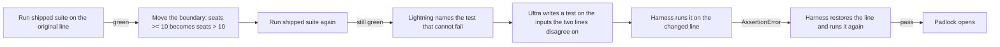

# Latch

A green test suite is not proof that an agent's pull request is correct. Latch is the gate that checks.

Coding agents now write the code and the tests in the same pull request. The tests pass, the reviewer sees green, and the change merges. The failure is quiet: a test that calls the changed function but cannot fail. Latch finds that test, has NVIDIA Nemotron write one that can fail, and opens only when the harness, not a model, watches the new test go red on the bug and green on the fix.

## The problem, in the words of people hitting it

- "All 12 tests passed. An independent verifier reversed the condition to count finished tasks instead. All 12 still passed." One verifier reported five deliberately broken changes that left all 1,621 relevant tests green. [@NatureBlueee](https://x.com/NatureBlueee/status/2115186551407944177)
- "Use a precommit hook to require an agent to run tests before committing." [@wmertens](https://x.com/wmertens/status/2115473040624554360)
- "No merge of agent patches until upstream is green AND patch tests pass on the rebased tip." [@DYoung_AI](https://x.com/DYoung_AI/status/2115470900808102089)
- Claude Code can commit without running tests: [anthropics/claude-code#35042](https://github.com/anthropics/claude-code/issues/35042).

Running the tests is not enough. The tests have to be able to fail.

## What a run does

The pull request in `latch/fixture/` changes an annual plan discount. `billing.py` grants it at 10 seats or more. The shipped suite checks a monthly plan, 12 annual seats, and 3 annual seats, and it has a test for exactly 10 seats that asserts the result equals itself.



1. The harness runs the suite on the original source. It must pass.
2. The harness moves the boundary from `>=` to `>`. The suite must still pass. That is the hole.
3. `nvidia/Nemotron-3_5-Lightning` reads the change and the tests and names the test that still passes when the line is wrong.
4. `nvidia/Nemotron-3-Ultra-550b-a55b` reads both versions of the source and the suite and writes one test function.
5. The harness writes that function to `test_kill.py` and runs it on the changed line. It must fail with an `AssertionError`.
6. The harness restores the line and runs it again. It must pass.
7. Only then does the padlock read Open.

## Why two models

Lightning is the fast read: one sentence, naming the weak test, so the engineer knows what the agent got wrong. Ultra does the hard step: reasoning over two near-identical sources to find the inputs where they disagree, then writing an executable test on exactly those inputs. Both calls go to Nebius Token Factory at `https://api.tokenfactory.nebius.com/v1/chat/completions`.

Nano and Super serverless ids are removed from Token Factory on 2026-11-09, before judging. Latch calls only Ultra and Lightning, and refuses to call a model id that is missing from the live catalog.

## When the padlock stays shut

The padlock is Shut when the run starts and stays Shut unless every check below holds. Each refusal is a code path in `latch/run.py`, and the screen shows the reason.

| Refusal | Why |
| --- | --- |
| The suite fails on the original source | The pull request is broken for a plainer reason |
| The changed line is not actually changed, or the suite already fails on it | There is no hole to close |
| The model id is not in the live Token Factory catalog | A removed model cannot be the proof |
| The system prompt contains the answer | Ultra must find the inputs itself |
| Ultra returns no function, or one that never calls `discount_applies(10, ...)` | Prose and off-target tests are rejected by the parser |
| The new test fails with anything other than `AssertionError` on the change | An import error or crash is not a caught bug |
| The new test fails after the line is restored | A test that fails everywhere proves nothing |
| Timeout or HTTP error | The screen shows the status code |

## Proof run

`latch/runs/latest.json` is the last live run.

- Shipped suite on the original line: green. On `seats > 10`: still green.
- Lightning, HTTP 200: "The test `test_ten_seats_ran` still passes despite the changed line being wrong, because it uses a tautological `assertIs(applied, applied)` that doesn't actually verify the discount logic."
- Ultra, HTTP 200, completion `chatcmpl-87fee6d9c6662143`, wrote:

```python
def test_ten_seats_annual_discount(self):
    self.assertTrue(discount_applies(10, True))
    self.assertEqual(annual_price_cents(10), 10 * 800)
```

- On `seats > 10` it failed with `AssertionError`. After restore it passed. Padlock: Open.

## Prior art

Mutation testing is old. [mutmut](https://github.com/boxed/mutmut) (BSD-3-Clause, 1,513 stars) flips operators and reports survivors. [Flawd](https://fixture.dev/flawd) mutation-tested 10 projects and found TypeORM's unit tests killed 72.6% of mutants. Its `flawd handoff` packages each survivor for a coding agent.

Latch starts where those end. It does not report survivors for a person to triage. It closes the loop on the pull request: a fast model explains the hole, a large model writes the fix, and the harness, which no model controls, decides whether the fix is real.

## Run it

Python 3.10 or newer, no dependencies. Put `NEBIUS_API_KEY` in the environment, or as an `export` line in `~/.zshrc`.

```
python3 latch/serve.py
```

Open http://127.0.0.1:4173/ and press Run the gate.

Tests:

```
python3 -m unittest latch.harness.test_parse latch.harness.test_kill_check latch.harness.test_prose latch.screen.test_render
```

## Layout

- `latch/run.py`: the gate. Runs the suite, moves the line, calls Lightning and Ultra, runs the new test both ways.
- `latch/serve.py`: local server for the screen and the run API.
- `latch/screen/page.py`: the screen.
- `latch/harness/`: parser and the AssertionError check, with tests.
- `latch/fixture/`: the pull request under test and the line flipper.
- `docs/WIN-CONDITIONS.md`: the pre-code decision.
- `research/`: everything read and tested along the way. Start at `research/README.md`.

## License

MIT. See `LICENSE`.
